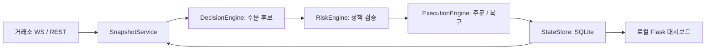

# GPT Trader

LLM이 제안한 주문을 정책으로 검증하고, 거래소 응답과 주문 상태를 SQLite에 기록하는 Python 백엔드 학습 프로젝트입니다. 자동매매를 소재로 **외부 API의 불확실한 응답, 중복 주문 방지, 상태 복구와 감사 기록**을 다룹니다.

포트폴리오의 중심은 수익률이 아니라 판단·위험 관리·실행·저장을 분리한 과정입니다. 아래 테스트는 가짜 거래소를 사용하며, 실제 거래소에서의 수익성이나 운영 안정성을 입증하지 않습니다.

## 주요 기능과 구현 상태

| 영역 | 코드에 구현된 내용 | 검증 범위·제약 |
| --- | --- | --- |
| 판단 | provider adapter, Pydantic `TradeIntent`, 입력 해시, 판단 캐시 | SDK 호출은 모의 응답으로 검사; 실제 모델 품질 미검증 |
| 위험 관리 | 정책 기반 심볼·노출·손실 제한, 주문 검증 | 단위 테스트; 정책 수치가 최적이라는 의미는 아님 |
| 주문 실행 | clientOrderId, 취소 후 교체, 부분 체결 상태 전이 | 가짜 거래소의 실패 시나리오로 검증 |
| 복구 | 정상 WS 캐시 → REST 미체결/완료 목록, 주기적 recovery sweep | 완료 목록은 최근 20건; 장기 장애·조회 누락 시 차단이 유지될 수 있음 |
| 저장·조회 | SQLite audit/journal/fill/상태 전이, Flask 대시보드 | 임시 DB와 인프로세스 HTTP 테스트 |
| 학습 보조 배치 | 과거 케이스 검색, replay/shadow, 정책 후보 점수·승격 로직 | 구현된 실험 기능; 개선 효과·실거래 성과 미검증 |

## 구조와 책임



| 경로 | 책임 |
| --- | --- |
| `main.py` | 스냅샷·검증·실행·기록 및 주기적 복구를 연결 |
| `ai/` | LLM provider 연결, 구조화된 판단, 과거 케이스 검색 |
| `core/` | 데이터 모델, 위험·진입·포지션·실행 안전 정책 |
| `exchange/` | 거래소 어댑터, 시세/계좌 피드, 주문 실행 |
| `db/state_store.py` | SQL 저장·조회, 런타임 잠금과 상태 전이 |
| `batch/`, `tools/` | 메모리 갱신 및 replay 분석 |
| `dashboard/`, `utils/`, `tests/` | 운영 조회, 로그·알림, 테스트 |

Python은 데이터 처리와 API SDK를 함께 다루기 위해, CCXT/pybit는 REST·WS 연결을 위해 사용합니다. Pydantic은 LLM 출력과 내부 데이터 계약을 검증합니다. SQLite는 단일 프로세스 학습 환경에서 별도 DB 서버 없이 감사 기록을 살펴보기 위한 선택입니다. Flask는 로컬 조회 화면에 사용합니다. 대규모 분산 처리용 설계는 아닙니다.

## 핵심 문제와 해결 방식

**타임아웃은 주문 실패를 뜻하지 않습니다.** 주문마다 clientOrderId를 생성하고 네트워크 오류가 나면 같은 ID를 WS·REST에서 조회합니다. 새 ID로 재주문하지 않습니다. 복구한 응답의 거래소 ID와 체결량을 유지해 부분 체결을 추적합니다. WS 조회가 실패하거나 health가 정상이 아니면 REST로 넘어갑니다.

**모르는 주문을 시간 경과만으로 잊지 않습니다.** DB의 모든 `unknown` 주문을 집계해 BUY/SELL뿐 아니라 REPLACE_ENTRY도 차단합니다. 같은 실행 묶음에서 미확정 주문이 생겨도 이후 신규 진입을 보류합니다. 조회에서 일치하는 ID와 해석 가능한 상태를 확인해 DB를 갱신해야 차단이 해제됩니다. HOLD/CANCEL/위험 축소 경로는 별도로 유지합니다. 기존 `unknown_order_block_minutes`는 차단을 자동 해제하지 않습니다.

**취소 요청과 취소 완료를 구분합니다.** 교체 주문은 취소 확인 후에만 보냅니다. 취소 대상이 이미 전부 체결됐거나 취소 응답에 부분 체결이 확인되면 기존 수량으로 교체하지 않고 다음 판단으로 미룹니다.

**검색·평가 자료에도 검증 경계를 둡니다.** 벡터 인덱스를 원본 거래 케이스와 연결해 부적격 audit의 재사용을 막습니다. 정책 점수에서 confidence 보정 자료가 없으면 관측되지 않은 보너스를 주지 않습니다. 이 점수는 내부 평가용 휴리스틱입니다.

## 로컬 실행

Python 3.12에서 검증합니다. 아래 명령은 저장소 루트의 PowerShell 기준입니다. macOS/Linux는 `.venv/Scripts/python.exe` 대신 `.venv/bin/python`을 사용하세요.

### 1. 외부 API 없이 테스트

```powershell
python -m venv .venv
.venv/Scripts/python.exe -m pip install -r requirements-dev.txt
.venv/Scripts/python.exe -m pytest -q
.venv/Scripts/python.exe -m ruff check ai batch core dashboard db exchange utils main.py tests --select E9,F63,F7,F82
```

테스트용 `.env`나 API 키는 필요 없습니다. pytest 테스트는 외부 소켓 연결을 차단합니다. StateStore 테스트는 테스트별 임시 DB를 생성하고 자신이 만든 폴더만 정리합니다. 스타일 전체를 검사한 것이 아니라 실행 오류에 가까운 Ruff 규칙을 검사합니다.

### 2. 선택 사항: Bybit Demo 연동

```powershell
Copy-Item .env.example .env
```

[.env.example](.env.example)을 열어 **Demo 전용** `BYBIT_API_KEY`, `BYBIT_API_SECRET`을 설정합니다. `BYBIT_TRADING_MODE="demo"`를 유지하세요. 모델은 `AI_PROVIDER`와 해당 provider의 키·모델 환경 변수로 선택하며, 기본 예시는 Gemini입니다. `DB_PATH` 기본값은 `data/gpt_trader.db`입니다. 웹훅은 선택 사항이며 비워 둘 수 있습니다.

환경 변수에서 모드를 생략해도 demo가 기본값입니다. 이전 `BYBIT_TESTNET=true`는 모드를 생략한 경우 testnet을 선택합니다. 오타 모드는 거절됩니다. live는 명시적 설정으로만 선택됩니다.

```powershell
# Demo 키와 설정을 확인한 후에만 실행
.venv/Scripts/python.exe main.py
```

이 명령은 지속 실행되는 거래 루프입니다. Demo에서도 외부 거래소·LLM에 접속하며 모델 비용이 발생할 수 있습니다. 이번 포트폴리오 정리에서는 이 명령이나 실제 주문 API를 실행하지 않았습니다. 시장 데이터는 mainnet public API, 계좌·주문은 선택한 private 환경을 사용합니다.

대시보드는 `.venv/Scripts/python.exe -m dashboard.app`으로 실행하고 `http://127.0.0.1:5000`에서 확인합니다. DB가 없으면 새 로컬 DB가 생성됩니다. replay 버튼은 외부 LLM을 호출할 수 있습니다. 인증이 없는 로컬 도구이므로 외부에 배포하지 마세요.

## 한계와 다음 단계

- 주문 전 clientOrderId를 내구성 있게 기록하는 outbox는 없습니다. 거래소가 주문을 수신한 직후 프로세스가 종료되면 DB 기록이 빠질 수 있습니다. 정확히 한 번 실행을 보장하지 않습니다.
- REST 완료 목록 조회의 20건 제한, WS의 미체결 중심 캐시, 거래소 조회 지연이 복구 범위를 제한합니다. 미확정 상태는 데이터 삭제로 해제하지 말고 거래소와 대조해야 합니다.
- DB 쓰기 오류를 로그로만 처리하는 메서드가 남아 있습니다. 저장 실패 시 진입을 중단하는 정책과 통합 트랜잭션 검토가 필요합니다.
- 큰 `main.py`, `state_store.py`, `memory_updater.py`는 유지보수 부담입니다. 회귀 테스트를 유지하며 작은 책임부터 분리할 계획입니다.
- 의존성 일부가 하한만 지정되어 있습니다. 검증 버전 고정과 CI, 장시간 Demo 장애 복구 검증이 다음 과제입니다.

상세 구현은 [상세 운영 문서](docs/RUNTIME_DETAILS.md), 설계 의도는 [시스템 설계](TRADING_SYSTEM_DESIGN.md), 후속 과제는 [개선 로드맵](IMPROVEMENT_ROADMAP.md)을 참고하세요. 공개 전에는 [보안 점검](SECURITY.md)을 확인하세요.
